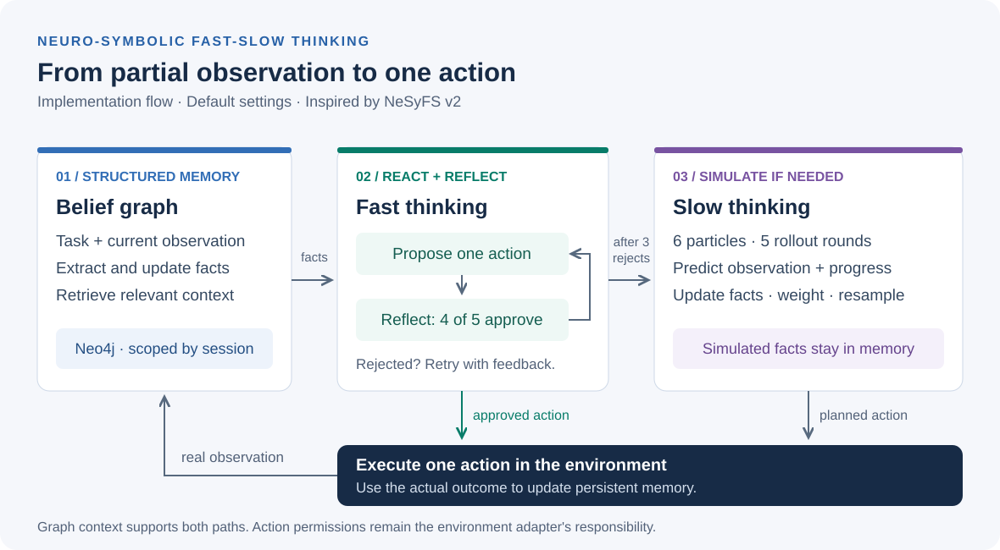

# NeSyFS

**Neuro-symbolic fast-slow agents for partially observable environments.**

A compact Python implementation inspired by [NeSyFS](https://arxiv.org/abs/2607.28942v2) by Duo Xu and Faramarz Fekri. The agent maintains a session-scoped fact graph in Neo4j, checks reactive actions through stepwise reflection, then falls back to particle-based planning when those actions are repeatedly rejected.

[Quickstart](#quickstart) · [Architecture](docs/architecture.md) · [Examples](examples/README.md) · [Configuration and reproduction](docs/reproduction.md) · [Paper reference](docs/paper.md)



## What is included

| Component | Implementation |
| --- | --- |
| **Structured memory** | Observation-to-fact extraction, stale-fact replacement and entity-based retrieval from a Neo4j graph isolated by episode ID. |
| **Fast thinking** | A LangChain policy proposes one action from the task, current observation and retrieved facts. |
| **Stepwise reflection** | Accepts a proposal when at least 80% of reflection votes agree. Rejected proposals receive corrective feedback. |
| **Slow thinking** | A lightweight TSMC-style planner simulates candidate trajectories, weights binary progress and resamples particles. |
| **Environment boundary** | A small kitchen simulator, a manual CLI mode and an adapter protocol for custom environments. |

This is an independent implementation, not the paper authors' benchmark release. ALFWorld, WebShop and ScienceWorld integrations are not included. The kitchen demo exercises the action/observation loop; it does not reproduce the paper's benchmark results. See the [paper-to-code comparison](docs/paper.md#paper-to-code-map) for implementation differences.

## Quickstart

### 1. Install the locked environment

Requires [uv](https://docs.astral.sh/uv/getting-started/installation/) and Python **3.14+**. The repository selects Python 3.14 through `.python-version`; uv can install it if needed.

```bash
git clone https://github.com/Shrey327/NeSyFs.git
cd NeSyFs
uv sync --locked
```

Try the deterministic environment walkthrough first. It uses scripted actions with **no API key or Neo4j server**:

```bash
uv run --locked python examples/kitchen_walkthrough.py
```

### 2. Configure the agent

The full agent requires an OpenAI API key plus a running Neo4j database. API calls may incur charges.

```bash
cp .env.example .env
```

Edit `.env`: set `OPENAI_API_KEY` and choose a `NEO4J_PASSWORD` of at least eight characters. Keep the default username `neo4j` when using the bundled local database configuration.

If you have Docker with Compose, start the local database:

```bash
docker compose up -d
docker compose logs -f neo4j
```

Wait for the database to report that it has started, then press Ctrl+C to leave the log viewer. Neo4j Browser is available at <http://localhost:7474>. Both published ports are bound to localhost. If you already run Neo4j, skip Docker and set its connection details in `.env` instead.

### 3. Run a kitchen episode

For the interactive showcase, start Docker and the database, then launch the local UI:

```bash
docker compose up -d
uv run --locked --env-file .env python showcase.py
```

Open <http://127.0.0.1:18765>, pick a model in the top bar (OpenAI or a running local Qwen server), select **Start episode**, then **Run one step** or **Auto-run**. The studio shows the live pipeline stage, each proposal with its reflection votes, planner rollouts when used, the belief graph, and every model call with latency, tokens and KV-cache reuse (tap a call for its prompt and output). The kitchen drawing follows the simulator state. The showcase supports the apple-and-fridge task only. It binds to localhost and is intended for local use.

The showcase defaults to `gpt-6-luna`, one reflection vote and attempt, and one planner particle and rollout step to reduce cost. Explicit `NESYFS_*` settings in `.env` override these defaults; for example, `.env.example` selects `gpt-4.1-mini`. These reduced settings differ from the research-oriented defaults described below. Each step makes multiple paid model calls, and model output and completion are not guaranteed. The event trace shows model-supplied rationale and observable system events, not hidden reasoning. Graph facts may include duplicates.

Stop the UI with Ctrl+C. Stop the database with `docker compose stop` (its data volume is retained). If port 18765 is busy, pass `--port 18766` and open that port instead.

### Compare configurations

Open **Comparison lab** in the showcase header, or visit <http://127.0.0.1:18765/evaluation.html>. Select one or more toy-kitchen scenarios, a repeat count, and a decision budget. Each task is run with the same model, initial observation, action grammar and budget under four configurations: reactive (last action and its result), history (prior actions and observations), graph memory plus reflection, and full adaptive (graph and reflection with planner fallback). Each episode has fresh environment state and a unique graph session. A rejected decision in the no-planner ablation consumes one decision without executing an action. Every observation after the first names the action it came from, and a rejected proposal's feedback is added to the next decision's observation; without this, greedy decoding sees an identical prompt and repeats the same failed or rejected choice. These are comparisons of this implementation, not the paper's benchmark baselines.

Four complex scenarios add locked containers and keys, washing, multiple objects, and goals that require restoring doors or the tap. They expose the same initial observations and rules to every configuration; later observations report the action outcome rather than the entire state. Changes are deterministic effects of actions, not timed disturbances. The dashboard's reference lengths are feasible solutions, not proven optima; choose at least that many decisions. The showcase defaults to one planner particle and one rollout, which do not provide meaningful particle diversity. Set `NESYFS_PARTICLE_COUNT` and `NESYFS_PLANNING_HORIZON` in `.env` to larger values for planning experiments, and expect more model calls and latency.

**Local model on this Mac.** An existing MLX runtime and Qwen3-1.7B 4-bit model can be used without downloading weights. In a separate terminal start the loopback-only server:

```bash
HF_HUB_OFFLINE=1 TRANSFORMERS_OFFLINE=1 ~/Documents/Stillroom/.venv/bin/mlx_lm.server \
  --model ~/Documents/stillroom-pr12-home/.models/assistant-qwen3-1.7b \
  --host 127.0.0.1 --port 18768 --allowed-origins http://127.0.0.1:18768 \
  --chat-template-args '{"enable_thinking":false}' --max-tokens 384 \
  --prompt-cache-size 16 --prompt-cache-bytes 1GB
```

Then start the showcase as above and choose **Local MLX · Qwen3 1.7B 4-bit** in Comparison Lab. This local option does not use the OpenAI key or fall back to OpenAI; Neo4j is still required. The paths refer to existing software and weights on this Mac, not files installed by this project. Model readiness only means the expected server and model were found. MLX does not enforce the JSON schema: the client validates responses and allows at most one correction for invalid JSON or schema output; a second invalid response stops the episode. The small model can still return incorrect facts or decisions. Local token counts are usage measurements, not API charges.

An optional, larger local model already on this Mac is **Qwen3-4B-Instruct-2507 4-bit**. To use it, run another local server and select the 4B option in the dashboard:

```bash
HF_HUB_OFFLINE=1 TRANSFORMERS_OFFLINE=1 ~/Documents/Stillroom/.venv/bin/mlx_lm.server \
  --model ~/Documents/Stillroom/.models/writer-qwen3-4b \
  --host 127.0.0.1 --port 18771 --allowed-origins http://127.0.0.1:18771 \
  --chat-template-args '{"enable_thinking":false}' --max-tokens 384 \
  --prompt-cache-size 16 --prompt-cache-bytes 1GB
```

**Local inference load.** Local calls use greedy decoding, so the client memoizes exact repeated prompts (repeated reflection votes, identical planner particles) instead of generating again; each task has its own output cap (128–384 tokens), and any `<think>` block is stripped. The server flags above keep the MLX prefix KV cache bounded to 1 GB; each task keeps a fixed instruction prefix so later calls reuse it. Re-observed facts update the existing graph fact instead of adding a duplicate, so prompts no longer grow every step.

The two local models are separate choices, not interchangeable measurements. Use a single provider and model for all conditions within a comparison. Both servers expose only local endpoints and have basic development-server security; do not expose them to a network.

Success comes from the simulator's goal state; the dashboard also shows actions, invalid or no-op actions, planner uses, elapsed time, errors, and provider-reported token usage where available. An error is reported separately even if an action changed the environment. Token totals can omit provider transport retries and are not an invoice; cost is not estimated. Runs are written incrementally to the Git-ignored `results/` directory. Settings, run order, source hashes, and the planner seed are recorded, but remote model responses and timing may vary even with the same seed. A run stopped by an error or interruption can be incomplete.

OpenAI episodes make live paid API calls; the MLX option uses the local model instead. Start with one task and one repeat; more tasks, repeats, decisions, or larger reflection/planning settings can greatly increase cost or local runtime. These scenarios are a small synthetic pilot, not ALFWorld, WebShop or ScienceWorld, and their results do not establish statistical significance or universal improvement. Paper-reported numbers remain separate in [the paper comparison](docs/paper.md).

Alternatively, run the agent in the terminal:

```bash
uv run --locked --env-file .env python main.py \
  --session-id "kitchen-$(date +%Y%m%d-%H%M%S)" \
  --task "Put the apple in the fridge" \
  --environment kitchen-demo \
  --max-steps 10
```

The CLI prints each chosen action, whether planning was used, the number of reflection attempts and the next observation. It stops when the kitchen reports completion or the step limit is reached. Actions are model-generated, so a successful run is not guaranteed.

Use a **fresh session ID for each independent episode**. Starting the kitchen again resets its state but does not clear old graph facts. The CLI verifies the database connection and creates uniqueness constraints on startup.

For manual interaction with an external environment, see [examples](examples/README.md#manual-environment). For connection errors, model configuration or cleanup, see [the run guide](docs/reproduction.md).

## How a step works

1. Extract relevant entities from the task and observation. Retrieve existing facts, update memory, then retrieve the current context.
2. Propose a reactive action. With the defaults, four of five reflection votes must approve it.
3. Retry with reflection feedback after rejection. After three rejected proposals, invoke the planner.
4. In the planner, simulate six particles for five rollout rounds. Reweight and resample after each round, then select the first action of a surviving trajectory.
5. Execute one action through the environment adapter. Update persistent memory from the actual outcome.

Hypothetical planner facts stay in memory and are never written to the persistent graph. Reflection is model judgment, not a safety guarantee; enforce action permissions in any real environment adapter.

## Repository guide

```text
main.py                       Episode CLI
src/nesyfs/
  config.py                   Environment-backed settings
  environments.py             Local kitchen simulator
  knowledge_graph.py          Neo4j fact storage and retrieval
  llm.py                      Policy and structured LLM tasks
  models.py                   Typed facts, predictions and step results
  planner.py                  TSMC-style particle planning
  service.py                  Step orchestration and environment protocol
examples/                     Scripted walkthrough and usage examples
tests/                        Offline unit tests
docs/                         Architecture, run guide and paper comparison
2607.28942v2.pdf               Bundled reference paper
```

## Development

```bash
uv sync --locked
uv run --locked python -m unittest discover -s tests -v
uv run --locked python -m compileall -q src main.py examples tests
```

Tests use fake model responses and a fake database driver. They check local behavior without making API calls or starting Neo4j. They are not live integration tests or benchmark evaluations. See [contribution guidance](CONTRIBUTING.md) before changing research behavior.

## Research reference

**Duo Xu and Faramarz Fekri.** *NeSyFS: A Neuro-symbolic Fast-Slow Thinking Framework for LLM Agent under Partial Observability.* arXiv:2607.28942v2, 2026.

[Versioned paper](https://arxiv.org/abs/2607.28942v2) · [Bundled PDF](2607.28942v2.pdf) · [BibTeX](docs/reference.bib) · [Paper-reported results and scope](docs/paper.md)

The documentation refers to **v2**, matching the bundled PDF. Paper results are attributed to the authors and are not measurements from this repository.

## License

No software license is currently specified. The bundled paper retains its original licensing terms; this change does not relicense it.
