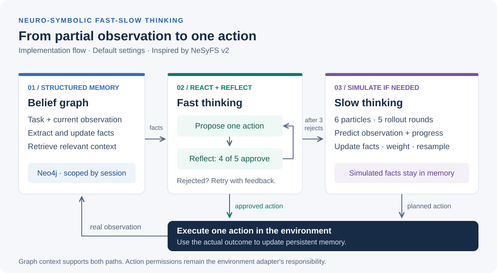

# Architecture

[Back to README](../README.md) · [Paper comparison](paper.md) · [Run guide](reproduction.md)

The implementation separates action selection from environment execution. `NeSyFSAgent.step()` returns one `StepResult`; the caller owns the episode loop.



## Module boundaries

| Module | Responsibility |
| --- | --- |
| [`config.py`](../src/nesyfs/config.py) | Read credentials, model selection and positive integer limits from environment variables. |
| [`models.py`](../src/nesyfs/models.py) | Pydantic schemas for facts, memory deltas, proposals, reflection votes, predictions and results. |
| [`knowledge_graph.py`](../src/nesyfs/knowledge_graph.py) | Parameterized Neo4j reads and transactional memory updates, scoped to a session. |
| [`llm.py`](../src/nesyfs/llm.py) | A LangChain `create_agent` reactive policy plus structured entity extraction, memory extraction, reflection and prediction calls. |
| [`planner.py`](../src/nesyfs/planner.py) | In-memory particle rollouts, binary progress weighting and resampling. |
| [`service.py`](../src/nesyfs/service.py) | Memory preparation, reactive/reflection loop, planner fallback and actual environment execution. |
| [`environments.py`](../src/nesyfs/environments.py) | Small deterministic kitchen simulator. |
| [`main.py`](../main.py) | Connection lifecycle, CLI input, episode limits and console output. |

## A single real step

1. **Prepare memory.** Extract entity names from the task and observation. Retrieve existing incident facts. Extract a `MemoryDelta` using the previous action plus current observation, then persist it. Expand the entity names with new fact subjects and objects before retrieving context again.
2. **React.** Propose an action using that context. The language model does not execute it.
3. **Reflect.** Collect `reflection_samples` structured votes. Acceptance requires `ceil(0.8 * reflection_samples)` positive votes. Feed rejected votes' feedback into the next proposal, up to `reflection_limit` attempts.
4. **Plan if needed.** When every reactive attempt is rejected, ask `TSMCPlanner` for an action. The planned action is not passed through another reflection vote.
5. **Act.** Call `environment.execute(action)` exactly once. Require a non-empty string response. Extract a memory delta from this real outcome and persist it.

The next step also processes the latest observation during memory preparation. Since insertion uses new fact IDs without semantic deduplication, repeated statements can accumulate. This is an implementation limitation, not a claim of canonical belief-state inference.

## Persistent graph

A subject and an object each connect to a fact node:

```text
(:NeSyEntity {session_id, name: subject}) -[:HAS_FACT]->
    (:NeSyFact {session_id, id, subject, predicate, object, observed_at, evidence})
(:NeSyEntity {session_id, name: object})  -[:HAS_FACT]-> same fact
```

- Composite uniqueness constraints cover `(session_id, name)` for entities and `(session_id, id)` for facts.
- Retrieval matches exact entity names, returns incident facts and caps results using `retrieval_limit`, ordered by newest timestamp. There is no embedding search or multi-hop traversal.
- New facts receive UUIDs. An LLM-provided list of superseded IDs identifies stale facts for removal within the same session.
- Each update stores at most the first 500 characters of its observation as fact evidence. Empty entity nodes may remain after stale facts are deleted.
- Session IDs provide query-level isolation. They are not database credentials or a multi-user authorization boundary.

## Simulated planning

Every particle starts with the current observation, a list copy of retrieved facts, an empty action list and weight `1.0`. Each rollout round:

1. Proposes an action for each particle.
2. Predicts the next observation and a binary progress label in one LLM call.
3. Multiplies weight by `exp(temperature)` for progress or by `1` otherwise.
4. Extracts a simulated memory delta, removes superseded IDs and appends simulated facts.
5. Resamples `particle_count` particles with replacement, copying action/fact lists and resetting weights to `1.0`.

After `horizon` rounds, the planner chooses a surviving particle uniformly and returns its first action. The constructor's `temperature=1.0` controls progress weighting; it is separate from the language model's generation temperature.

The planner never calls the environment or writes to Neo4j. It copies lists rather than deep-copying `Fact` objects, but the current implementation replaces fact-list contents without mutating existing facts. Keep that invariant when extending the planner.

## Operational limits

- All LLM tasks share a `ChatOpenAI` model configured with generation temperature `0`. Repeated calls do not guarantee diverse reflection votes or simulated futures.
- The stored graph is model-extracted context. It is neither verified world state nor a formal probability distribution.
- A model or database exception interrupts the step. There is no transactional rollback spanning environment execution and the following graph update.
- Keep real-world permissions, action allowlists and destructive-action confirmation in the environment adapter. Model reflection cannot replace those controls.

See [the paper-to-code map](paper.md#paper-to-code-map) for research-method differences and [the run guide](reproduction.md) for reproduction boundaries.
